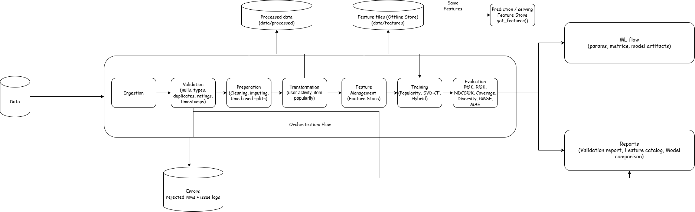

# End-to-End Data Management Pipeline for a Recommendation System

DM4ML Assignment 2. A modular, reproducible pipeline that ingests user / item / interaction data, validates it,
prepares and transforms it, manages features, trains a popularity baseline and personalized recommenders, evaluates
them, and orchestrates everything with Prefect. Experiments are tracked in MLflow.

> **Dataset.** The pipeline runs on a **documented synthetic
> MovieLens-style dataset** (`src/ingestion/generate_data.py`): 2,000 users, 800 items, ~109k raw interactions with a real
> latent taste structure plus ~1% deliberately injected defects (duplicates, nulls, bad types, invalid ratings/timestamps,
> orphan foreign keys). To use real data, drop `users.csv`, `items.csv`, `interactions.csv` (same columns) into `data/raw/`
> and set `ingestion.source: csv` in `configs/config.yaml`.

## Architecture


`Ingestion -> Validation -> Preparation -> Transformation -> Feature Management -> Training -> Evaluation`, wrapped in a Prefect flow.

## Setup
```bash
python -m venv .venv && source .venv/bin/activate      # Python 3.10+
pip install -r requirements.txt
```

## Run
```bash
python run_pipeline.py                  # plain sequential run (no orchestrator)
python dags/recommendation_flow.py      # same pipeline as a Prefect flow (ephemeral local run)
python dags/recommendation_flow.py --serve   # Prefect deployment, daily 02:00 cron
python -m pytest -q tests               # unit tests (validation rules, split, metrics)
mlflow ui --backend-store-uri sqlite:///mlflow.db   # browse runs (needs full `pip install mlflow`)
```
## Viewing the Prefect UI

Prefect starts a temporary server for each run, and it shuts down when the flow finishes. To inspect a run in the web UI, start a dedicated server instead.

**1. Start the Prefect server** (terminal 1; leave it running):

```bash
prefect server start
```

**2. Run the flow against that server** (terminal 2, from the project folder):

- Windows (Command Prompt):
  ```
  set PREFECT_API_URL=http://127.0.0.1:4200/api
  python dags/recommendation_flow.py
  ```
- macOS / Linux:
  ```bash
  PREFECT_API_URL=http://127.0.0.1:4200/api python dags/recommendation_flow.py
  ```

**3. Open the dashboard** at <http://127.0.0.1:4200>, go to **Runs**, and select the latest run to see the task graph and logs.

> The `--serve` option (`python dags/recommendation_flow.py --serve`) deploys the flow on a daily 02:00 schedule. Scheduling only works against a dedicated server like the one above, not the temporary one.

## Running individual stages

Each stage can also be run on its own:

| Goal | Command |
|---|---|
| Run a single stage | `python -m src.validation.validate` |
| Resume the full pipeline from a stage | `python run_pipeline.py --from train` |

Stage module names: `src.ingestion.ingest`, `src.validation.validate`, `src.preparation.prepare`, `src.transformation.transform`, `src.features.feature_store`, `src.training.train`, `src.evaluation.evaluate`.

Everything is seeded (`seed: 42` in the config); two consecutive full runs give byte-identical `reports/model_comparison.csv`.

## Project structure
```
configs/config.yaml        all parameters (paths, validation rules, split, K, model hyper-parameters, MLflow)
src/ingestion/             CSV ingestion (+ synthetic data generator)
src/validation/            rule-based validation -> errors dataset + report
src/preparation/           cleaning, imputation, de-duplication, time-based split
src/transformation/        user activity summary, item popularity, user-item matrix
src/features/              FeatureStore (build / serve) + feature catalog
src/training/              models (popularity, SVD CF, hybrid) + MLflow training
src/evaluation/            metrics + evaluation + comparison table
dags/recommendation_flow.py   Prefect flow (task dependencies, retries, schedule)
data/errors/               rejected rows and full issue logs
reports/                   validation report, feature catalog, model comparison
results/                   architecture diagram, Prefect run screenshots, final report
tests/                     pytest suite
```

## Stages in brief
| Stage | What it does | Key output |
|---|---|---|
| Ingestion | reads CSVs as text (so type errors are visible), adds `row_id` | `data/processed/*_raw.parquet`, `reports/ingestion_log.json` |
| Validation | nulls, duplicates, data types, rating range, timestamp format/range, referential integrity. **error** = row rejected; **warning** = kept and repaired later | `data/errors/*`, `reports/validation_report.md` |
| Preparation | type casting, median imputation, standardised IDs/strings, de-dup `(user,item)` keep latest, **time-based split** (last 20% of time = test) | `train/test.parquet`, `reports/split_info.json` |
| Transformation | user activity summary, item popularity, sparse user-item matrix, item-genre matrix (train only) | `data/processed/*` |
| Features | 8 user + 8 item + 3 interaction features, one `FeatureStore` for training and prediction | `data/features/*`, `reports/feature_catalog.md` |
| Training | Popularity baseline, SVD collaborative filtering, Hybrid (CF + genre affinity + popularity); params/artifacts to MLflow | `models/*.pkl` |
| Evaluation | Precision@10, Recall@10, NDCG@10, Coverage, Diversity, RMSE, MAE; metrics logged back to MLflow | `reports/model_comparison.md/.csv/.png` |


Design decisions, metric definitions and limitations are in `reports/Final_report.pdf`.

Screenshots of successful Prefect, MLflow and pipeline runs are in the [`results/`](results/) folder.
